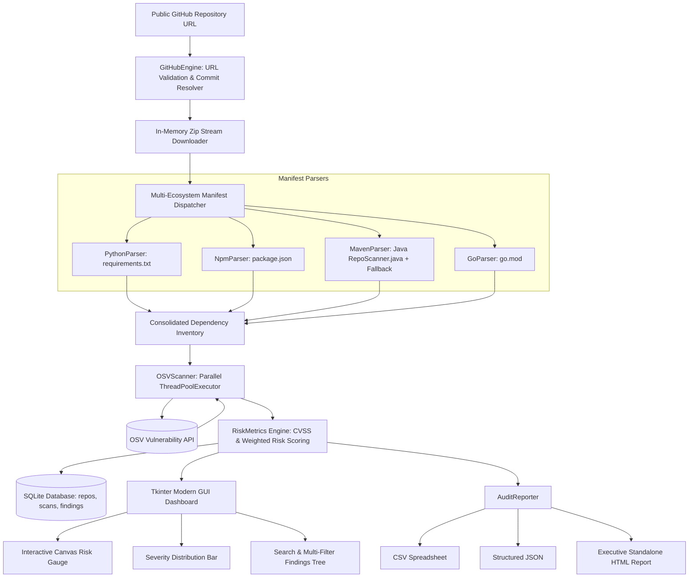

# 🛡️ RepoGuard: Multi-Ecosystem Security & Dependency Vulnerability Auditor

[](https://python.org)
[](https://openjdk.org)
[](https://sqlite.org)
[](LICENSE)
[]()

> **Academic Project Submission**  
> **Course:** AA1 &mdash; Advanced Programming Practices  
> **Faculty Guide:** Dr. Rajesh Kannan  
> **Development Team:**
> - **Shantnu** (Team Lead & Core Backend Architect)
> - **Arya Agrawal** (Frontend GUI & Data Visualization Engineer)
> - **Raiyan Kamal** (Database, Java XML Parser & Multi-Ecosystem Engineer)

---

## 📌 Executive Overview

**RepoGuard** is a high-performance desktop security and software supply-chain auditing application. It performs non-intrusive, automated dependency vulnerability discovery across public GitHub repositories. 

Unlike traditional scanners that clone whole repositories or extract archives to disk (exposing systems to directory-traversal and malicious script vulnerabilities), RepoGuard operates **100% in-memory**. It stream-parses manifests, queries the distributed **Open Source Vulnerabilities (OSV)** database in parallel, generates dynamic risk scores, and displays interactive canvas-rendered visualizations alongside rich exportable reports (CSV, JSON, and self-contained executive HTML).

---

## 🚀 Key Innovations & Distinct Features

| Feature | RepoGuard (Our Implementation) | Standard Basic Scanners |
| :--- | :--- | :--- |
| **Supported Ecosystems** | **Python** (`requirements.txt`), **Node.js** (`package.json`), **Java** (`pom.xml`), and **Go** (`go.mod`) | Typically limited to 1-2 formats |
| **Java XML Engine** | Native Java DOM parser with `${property}` resolution & fallback Python XML parser | Rigid, fails when properties are present |
| **GUI Visualizations** | Custom **Tkinter Canvas Risk Gauge** (0–100) and **Severity Distribution Chart** | Plain tabular text lists only |
| **Execution Architecture** | Non-blocking multi-threaded daemon workers with `ThreadPoolExecutor` and thread-safe queue | Blocking UI freezes during network calls |
| **Execution Modes** | Both **Full Desktop GUI** and **Headless CLI Pipeline Mode** (`--cli`) | Single desktop script only |
| **Reporting Engine** | Generates **CSV, JSON**, and responsive standalone **Executive HTML Security Reports** | Basic CSV export only |
| **Security Architecture** | Zero-disk extraction, strictly in-memory zip stream parsing, path sanitization | Extracts unverified zip files to local disk |

---

## 🏗️ System Architecture



---

## 👥 Team Workload & Contribution Breakdown

| Team Member | Project Role | Core Responsibilities & Deliverables |
| :--- | :--- | :--- |
| **Shantnu** | **Team Lead & Core Backend Architect** | • Designed asynchronous GitHub archive streaming engine (`core/github_engine.py`).<br>• Implemented parallel multi-threaded worker pool for OSV API lookups (`core/osv_scanner.py`).<br>• Built CLI headless pipeline mode and application entrypoint (`main.py`). |
| **Arya Agrawal** | **Frontend GUI & Data Visualization Engineer** | • Architected modern dark-themed Tkinter GUI window and Notebook layout (`gui/main_window.py`).<br>• Designed custom interactive **Tkinter Canvas Risk Gauge** and **Severity Distribution Bar Chart** (`gui/charts.py`).<br>• Implemented executive standalone HTML audit report generator (`core/reporter.py`). |
| **Raiyan Kamal** | **Database, Java Parser & Multi-Ecosystem Engineer** | • Designed normalized SQLite database schema, indices, and ORM layer (`core/db_manager.py`).<br>• Developed hardened Java Maven DOM parser with property substitution (`java/RepoScanner.java`).<br>• Implemented Go modules (`go.mod`) parser and pure-Python XML fallback parser (`parsers/`). |

---

## 🛠️ Prerequisites & Installation

### Requirements
- **Python:** 3.9, 3.10, 3.11, 3.12, 3.13, or 3.14 (with Tkinter included by default on Windows/macOS)
- **Java:** JDK 11+ with `javac` and `java` on `PATH` (optional for Maven; an automated Python fallback is included)
- **Operating System:** Windows 10/11, macOS, or Linux

### Quick Setup

Clone this repository:
```bash
git clone https://github.com/Shantnu01/APP.git
cd APP
```

*(No heavy third-party pip dependencies required; RepoGuard is built using standard libraries and native Tkinter for maximum reliability and portability!)*

---

## 🖥️ How to Run

### 1. Windows (One-Click)
Double-click **`run.bat`** or run in PowerShell:
```powershell
python main.py
```

### 2. Linux / macOS
```bash
chmod +x run.sh
./run.sh
```

### 3. Headless CLI Mode (Command Line)
You can run automated security audits directly from your terminal:
```bash
# Output summary to console
python main.py --cli https://github.com/Shantnu01/APP

# Generate a standalone executive HTML report directly
python main.py --cli https://github.com/Shantnu01/APP --format html
```

---

## 🧪 Demo Repositories for Testing

Paste any public GitHub repository into RepoGuard to test multi-ecosystem scanning:

1. **Target Repository Audit:**
   ```
   https://github.com/Shantnu01/APP
   ```
   *Scans the repository's declared dependencies, resolving packages against real-time OSV advisories.*

2. **Any Public GitHub Repository:**
   ```
   https://github.com/pallets/flask
   ```
   *Demonstrates direct Python and web dependency auditing.*

---

## 📊 Running Unit Tests

Run the comprehensive unit test suite covering parsers, risk scoring, and database transactions:
```bash
python -m unittest discover -s tests
```

---

## 📜 Academic Integrity & Disclaimer
This project was developed strictly for academic demonstration in **Course AA1 - Advanced Programming Practices** under the guidance of **Dr. Rajesh Kannan**. It reports known published CVE and GHSA advisories from the OSV database and is designed to teach secure software engineering, multi-threading, inter-language process integration, and data visualization.
